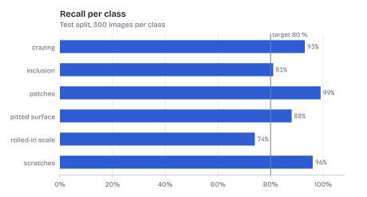

# FigureKit

One figure style for all my projects. It renders matplotlib figures in a light and a dark theme
and writes them as transparent SVG and PNG, ready for a README, the portfolio and slides.

<picture>
  <source media="(prefers-color-scheme: dark)" srcset="docs/examples/bars-dark.svg">
  
</picture>

- **Looks like the portfolio.** Text and line colours come from the portfolio tokens, the type is
  Bricolage Grotesque with JetBrains Mono for numbers, and both fonts are bundled.
- **Readable in both modes.** The series colours are validated for colour-vision deficiencies
  against the light and dark page colours. Text colours reach WCAG contrast, checked in the tests.
- **Transparent.** One file per mode fits every page colour of that mode.
- **Reproducible.** The same figure gives byte-identical SVGs. The files carry no date or version.
- **Checked.** `figkit check` fails CI on missing light/dark pairs, opaque backgrounds and
  oversized files.

## Install

```sh
uv add "figkit @ git+https://github.com/BenBotsch/FigureKit@v0.1.1"
```

Pin a tag, so a style change reaches a project only when it updates the tag.

## Use

A figure is a function of the theme. `render` calls it once per theme and writes every output:

```python
from pathlib import Path

import matplotlib.pyplot as plt
import figkit


def recall(theme: figkit.Theme) -> plt.Figure:
    figure, ax = plt.subplots(figsize=(6.4, 3.2))
    bars = ax.barh(["crazing", "inclusion", "patches"], [0.93, 0.81, 0.99], color=theme.series[0])
    figkit.bar_labels(ax, bars, theme, fmt="{:.0%}")
    figkit.reference_line(ax, 0.8, "target 80 %", theme)
    figkit.category_axis(ax, "y")
    figkit.percent(ax, "x")
    figkit.title(ax, "Recall per class", theme, subtitle="Test split")
    return figure


figkit.render(Path("docs/figures"), "recall", recall)
# docs/figures/recall.svg, recall-dark.svg, recall.png, recall-dark.png
```

| Output | Files |
| --- | --- |
| `WEB` (default) | transparent SVG and PNG at 250 dpi |
| `PHOTO` | transparent WebP and PNG, for images and overlays |
| `CARD` | opaque 1200 x 630 PNG for Open Graph; draw on `CARD_INCHES` |

Helpers: `title`, `legend_top`, `grid`, `percent`, `category_axis`, `mono_ticks`, `value`,
`bar_labels`, `reference_line`, `ink_on`, `hex_colour`. `figkit.styled(theme)` applies the
style without writing files, for example in a notebook.

In CI:

```sh
uv run figkit check docs/figures
```

## Rules

[docs/style-guide.md](docs/style-guide.md) covers which form fits which data, how colours are
assigned, layout, file names, embedding and alt text. [docs/examples](docs/examples) shows the
gallery from `scripts/examples.py`.

## Development

```sh
uv sync
uv run ruff check . && uv run ruff format --check . && uv run mypy && uv run pytest
uv run python scripts/examples.py      # regenerate the gallery
uv run --no-project --with fonttools python scripts/build_fonts.py   # rebuild the static fonts
```

Colours and type sizes live only in [src/figkit/tokens.json](src/figkit/tokens.json).

## License

Code: MIT. Fonts in `src/figkit/fonts`: SIL Open Font License 1.1, see the `OFL-*.txt` files.
They are static cuts of the variable fonts, made with fontTools from pinned Google Fonts sources.
Neither font declares a Reserved Font Name.
