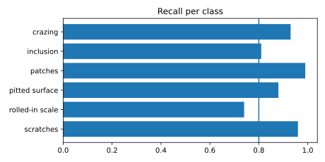
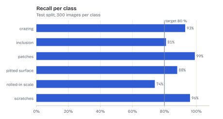
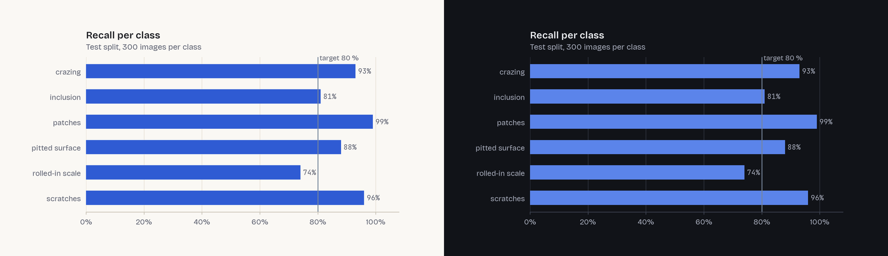
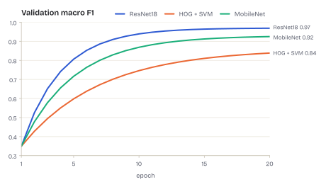
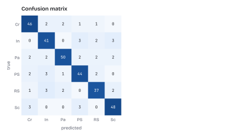
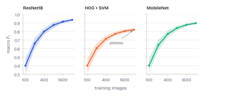
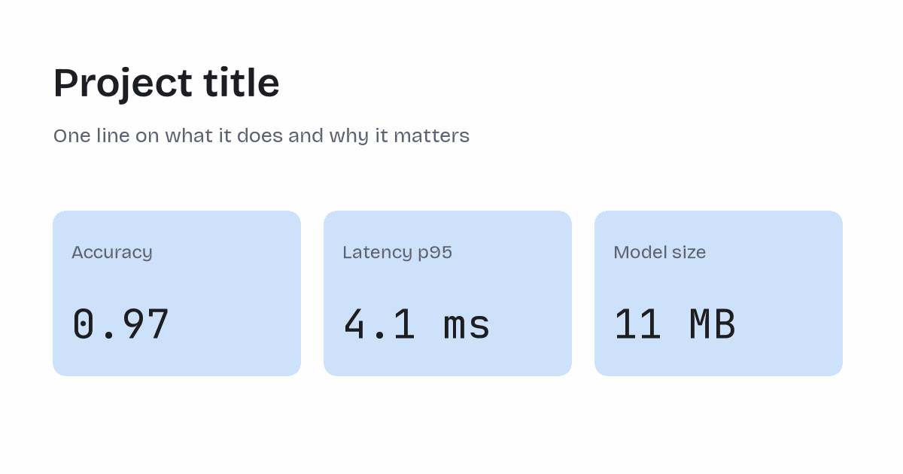
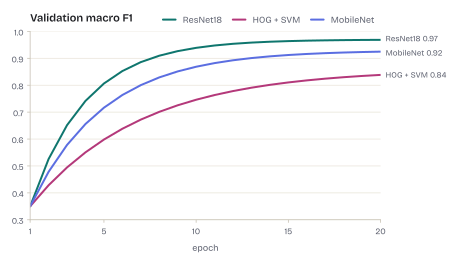
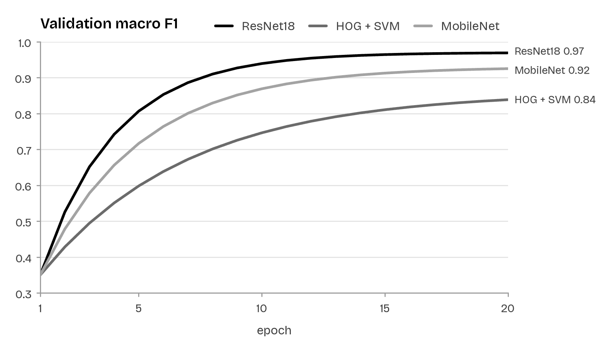

<div align="center">

# FigureKit

**Publication-ready matplotlib figures in one consistent style, for READMEs, websites and slides.**

[](https://github.com/BenBotsch/FigureKit/actions/workflows/ci.yml)
[](https://github.com/BenBotsch/FigureKit/releases)

[](LICENSE)

[Quickstart](#quickstart) · [Recipes](#recipes) · [Websites](#figures-for-a-website) ·
[Your own style](#a-style-of-your-own) · [CLI](#command-line) · [API](#api)

</div>

A figure is a function of the theme. FigureKit draws it once per theme, such as light and dark,
and once per language, writes transparent SVG and PNG files that are byte-identical on every
run, and checks them in CI.

<table>
  <tr>
    <th>Plain matplotlib</th>
    <th>With FigureKit</th>
  </tr>
  <tr>
    <td width="50%"></td>
    <td width="50%"><picture>
      <source media="(prefers-color-scheme: dark)" srcset="docs/examples/bars-dark.svg">
      
    </picture></td>
  </tr>
</table>

## Features

- **One style, many projects.** The bundled style matches the portfolio, with Bricolage Grotesque
  and JetBrains Mono for numbers, both bundled. A project brings its own style with any number of
  themes in one JSON file.
- **Light and dark, transparent.** One file per theme fits every page colour of that theme:

  

- **Accessible.** Series colours are validated for colour-vision deficiencies against the page
  colours; text colours reach WCAG contrast, checked in the tests. Text below 8 pt is an error.
- **Reproducible.** The same figure gives byte-identical SVGs on Linux and Windows, without date
  or version, so diffs show only real changes.
- **Two languages.** Website figures come without title in every language, German numbers
  included, with a `figures.json` of titles and alt texts.
- **Checked in CI.** `figkit check` fails on missing theme or language pairs, opaque backgrounds,
  figures off the canvas, small text, oversized files, missing alt texts and page colours that
  differ from the website's stylesheet.

### Why not a matplotlib style sheet?

A style sheet sets colours and fonts for one look. It does not draw a figure once per theme and
language, keep files transparent and reproducible, name them for `<picture>` and the website,
or check in CI that every pair exists and the colours match the stylesheet of the website.

## Quickstart

**1. Install** from PyPI. The package is called `figurekit`, the module and the command `figkit`.
`uv.lock` pins the version, so a style change reaches a project only when it upgrades:

```sh
uv add figurekit
```

**2. Draw** a figure as a function of the theme and let `render` write it:

```python
from pathlib import Path

import matplotlib.pyplot as plt
import figkit


def recall(theme: figkit.Theme) -> plt.Figure:
    figure, ax = plt.subplots(figsize=(figkit.WEB_WIDTH, 3.2))
    bars = ax.barh(["crazing", "inclusion", "patches"], [0.93, 0.81, 0.99], color=theme.series[0])
    figkit.bar_labels(ax, bars, theme, fmt="{:.0%}")
    figkit.reference_line(ax, 0.8, "target 80 %", theme)
    figkit.category_axis(ax, "y")
    figkit.percent(ax, "x")
    figkit.title(ax, "Recall per class", theme, subtitle="Test split")
    return figure


figkit.render(Path("docs/figures"), "recall", recall)
```

```text
docs/figures/
├── recall.svg        light, transparent, 6.4 in canvas
├── recall-dark.svg
├── recall.png        1600 px wide
└── recall-dark.png
```

**3. Embed** both files; the browser picks the one of its mode:

```html
<picture>
  <source media="(prefers-color-scheme: dark)" srcset="docs/figures/recall-dark.svg">
  
</picture>
```

**4. Check** in CI:

```sh
uv run figkit check docs/figures
```

`figkit.styled(theme)` applies the style without writing files, for example in a notebook.

## Recipes

Each recipe is an excerpt of [`scripts/examples.py`](scripts/examples.py), which draws the whole
[gallery](docs/examples) from invented data.

<details>
<summary><b>Lines with labels at their ends</b> instead of a legend lookup</summary>

<picture>
  <source media="(prefers-color-scheme: dark)" srcset="docs/examples/lines-dark.svg">
  
</picture>

```python
for slot, (name, score) in enumerate(models.items()):
    ax.plot(epochs, score, color=theme.series[slot], label=name)
    ends.append((epochs[-1], score[-1], f"{name} {score[-1]:.2f}"))
figkit.title(ax, "Validation macro F1", theme)
figkit.legend_top(ax)
figkit.grid(ax, "y")
figkit.line_labels(ax, ends, theme)  # moves labels apart where lines end close together
```

</details>

<details>
<summary><b>Heatmap</b> on the sequential ramp with readable cell values</summary>

<picture>
  <source media="(prefers-color-scheme: dark)" srcset="docs/examples/heatmap-dark.svg">
  
</picture>

```python
cmap = figkit.ramp_cmap(theme)
ax.imshow(rates, cmap=cmap, vmin=0, vmax=1)
for (i, j), count in np.ndenumerate(counts):
    cell = figkit.hex_colour(cmap(rates[i, j]))
    figkit.value(ax, j, i, str(count), theme, ha="center", va="center", color=figkit.ink_on(cell))
```

</details>

<details>
<summary><b>Small multiples</b> with shared axes, confidence bands and a callout</summary>

<picture>
  <source media="(prefers-color-scheme: dark)" srcset="docs/examples/multiples-dark.svg">
  
</picture>

```python
figure, panels = figkit.small_multiples(3, height=2.2)  # inner panels drop shared tick labels
for slot, (ax, (name, mean, spread)) in enumerate(zip(panels, curves)):
    ax.plot(sizes, mean, color=theme.series[slot], marker="o", markersize=3)
    figkit.band(ax, sizes, mean - spread, mean + spread, theme, slot=slot)
figkit.callout(panels[1], "plateau", (3200, plateau), (-22, -22), theme)
```

`figkit.error_bars(ax, x, y, error, theme)` draws thin bars without caps in the secondary ink
for points instead of lines.

</details>

<details>
<summary><b>Social card</b> for Open Graph, 1200 x 630</summary>



```python
def card(theme: figkit.Theme) -> plt.Figure:
    figure = plt.figure(figsize=figkit.CARD_INCHES)
    ...
    ax.text(x, y, "0.97", fontsize=26, fontfamily=figkit.mono(theme))
    return figure


figkit.render(out, "card", card, outputs=figkit.CARD)  # opaque PNG
```

</details>

<details>
<summary><b>Notebook</b> without files</summary>

```python
with figkit.styled(figkit.DARK):
    figure = recall(figkit.DARK)
```

</details>

## Outputs

| Output | Files |
| --- | --- |
| `WEB` (default) | transparent SVG and PNG on a 6.4 in canvas, the PNG 1600 px wide |
| `PHOTO` | transparent WebP and PNG, for images and overlays |
| `CARD` | opaque 1200 x 630 PNG for Open Graph; draw on `CARD_INCHES` |

## Figures for a website

The website shows the title as text, so its files leave it out. `page` draws the figure once per
language, the draw function receives the language as its first argument, and `write_manifest`
lists the files with their texts:

```python
TEXT = {
    "en": figkit.Caption("Recall per class", "All classes above 80 % but scale."),
    "de": figkit.Caption("Recall je Klasse", "Alle Klassen über 80 % außer Zunder."),
}


def recall_page(language: str, theme: figkit.Theme) -> plt.Figure:
    # Labels from a table per language, numbers with figkit.number(0.74, ".0%").
    return draw_recall(LABELS[language], theme)


out = Path("docs/figures/page")
figkit.write_manifest(out, [figkit.page(out, "recall", recall_page, TEXT)])
```

```text
docs/figures/page/
├── recall.de.svg   recall.de-dark.svg
├── recall.en.svg   recall.en-dark.svg
└── figures.json    titles, alt texts and files per language and theme
```

A figure that a separate step draws, because it needs a trained model for example, is written
there with `page`. `figkit.page_entry(out, name, TEXT, figkit.PHOTO[0])` then reads its entry from
the files, so one step can still write the manifest of all figures.

In German, tick labels, the values of `bar_labels` and `figkit.number` write `0,74`, `1.500` and
`74 %`; category names and other text come from the project.

## A style of your own

The bundled style is the portfolio's. Another project describes its own in a tokens file.
[`docs/examples/style/tokens.json`](docs/examples/style/tokens.json) is a complete example with
other series colours and a `print` theme; the same line chart in it:

<table>
  <tr>
    <th>light, paired with dark</th>
    <th>print, without a pair</th>
  </tr>
  <tr>
    <td width="50%"><picture>
      <source media="(prefers-color-scheme: dark)" srcset="docs/examples/style/lines-dark.svg">
      
    </picture></td>
    <td width="50%"></td>
  </tr>
</table>

Its outline:

```json
{
  "$schema": "../../../src/figkit/tokens.schema.json",
  "version": 2,
  "default": "light",
  "font": {"sans": "Bricolage Grotesque", "mono": "JetBrains Mono", "size": 9, "…": "…"},
  "themes": {
    "light": {"pair": "dark", "pages": ["#faf8f4", "#ffffff"], "series": ["#0f766e", "…"], "…": "…"},
    "dark":  {"pair": "light", "…": "…"},
    "print": {"pages": ["#ffffff"], "…": "…"}
  }
}
```

Copy it as a start and point `$schema` to
[`tokens.schema.json`](src/figkit/tokens.schema.json) for completion and validation in the editor.
Each theme needs `pages`, `surface`, `ink`, `secondary`, `muted`, `grid`, `axis`, `series`, `ramp`
and `status`.

| Key | Meaning |
| --- | --- |
| `default` | Theme whose files carry no suffix; every other theme writes `-<name>`. |
| `pair` | Theme a page swaps with, such as light and dark. `figkit check` requires the file of the pair; a theme without one stands alone. |
| `font.math` | Fonts of formulas between dollar signs: `italic`, a family with an italic face for variables and Greek letters, by default DejaVu Sans, and `fallback`, the matplotlib font for other missing characters, `cm`, `stix` or `stixsans` (default). |
| `font.files` | Glob patterns of font files, relative to the tokens file; without them the bundled fonts apply. matplotlib keeps one file per family in a process, so own font files need family names of their own. |
| `css` | Maps custom properties of the website, `--color-text: light-dark(#111111, #eeeeee)`, to tokens such as `["ink"]` or `["pages", 0]`. `figkit check --css` compares the first colour with the default theme and the second with its pair. |

`figkit.load_style(path)` rejects unknown keys and lists every problem with its place, such as
`themes.dark.series[2]: 'blue' is not a #rrggbb colour`. The style goes to `render`, `page`,
`page_entry` and `check`:

```python
style = figkit.load_style(Path("docs/examples/style/tokens.json"))
figkit.render(Path("docs/figures"), "lines", lines, style=style)
# lines.svg, lines-dark.svg, lines-print.svg and the PNGs
```

A project names its style once in its `pyproject.toml`. Scripts read it with
`figkit.project_style()`, and `figkit check` uses it unless `--style` or `--css` say otherwise:

```toml
[tool.figkit]
tokens = "figures/tokens.json"              # relative to pyproject.toml
css = "../Website/src/styles/tokens.css"
```

`figkit init` starts such a project: it copies the bundled tokens and their schema to
`figures/tokens.json` and appends the table. `figkit style preview` then draws every series,
the ramp and the status colours in each theme, so a change to the tokens shows before a real
figure uses it.

## Command line

```sh
figkit check [DIRECTORY ...] [--a11y] [--css CSS] [--style TOKENS] [--opaque NAME] [--any-width]
figkit init [--tokens TOKENS] [--css CSS]
figkit style preview [DIRECTORY] [--style TOKENS]
```

`init` writes the tokens file, default `figures/tokens.json`, and its schema unless the file
exists, and appends `[tool.figkit]` to the `pyproject.toml` of the working directory. It stops
if the table is there already. `style preview` renders `style.svg` and `style.png` in every
theme to `DIRECTORY`, default `figkit-preview`, from `--style` or `[tool.figkit]`. Text below
the minimum size of the style fails the preview.

`check` takes these options:

| Option | Effect |
| --- | --- |
| `DIRECTORY` | Folders of figures to check: theme and language pairs, transparency, canvas width, text size, file size and `figures.json`. |
| `--css CSS` | Compares the page, text and line colours with a stylesheet (alias `--tokens`). |
| `--style TOKENS` | Style that wrote the figures; overrides `[tool.figkit]`. |
| `--opaque NAME` | Figure that is opaque on purpose; repeatable, default `card`. |
| `--any-width` | Does not require the fixed canvas width of web figures. |
| `--a11y` | Checks the colours of the style: text contrast (WCAG), the separation of neighbouring series under protanopia, deuteranopia and normal vision, and an evenly stepped ramp. Works without a directory. |

The exit code is 1 on any problem:

```console
$ uv run figkit check docs/figures docs/figures/page
docs/figures/recall.svg: missing its pair recall-dark.svg
$ uv run figkit check --css ../Portfolio/src/styles/tokens.css
../Portfolio/src/styles/tokens.css: ok
```

## API

<details>
<summary>All public names, by area</summary>

| Area | Names |
| --- | --- |
| Render | `render`, `page`, `page_entry`, `write_manifest`, `save`, `path_for`, `canvas`, `styled`, `headless` |
| Outputs | `WEB`, `PHOTO`, `CARD`, `SVG`, `PNG`, `WEB_WIDTH`, `CARD_INCHES`, `RASTER_DPI` |
| Helpers | `title`, `legend_top`, `grid`, `percent`, `category_axis`, `mono`, `mono_ticks`, `value`, `bar_labels`, `reference_line`, `line_labels`, `band`, `error_bars`, `callout`, `small_multiples`, `ramp_cmap`, `ink_on`, `hex_colour` |
| Languages | `Caption`, `language`, `localize`, `number` |
| Style | `Theme`, `Typography`, `Style`, `StyleError`, `load_style`, `parse_style`, `DEFAULT`, `LIGHT`, `DARK`, `THEMES`, `TYPE`, `tokens`, `rc`, `register_fonts` |
| Project | `Project`, `project`, `project_style` |
| Checks | `check_text`, `complete_glyphs` and the `figkit check` command |

Importing figkit leaves the matplotlib backend alone; a batch job that only writes files can set
`MPLBACKEND=Agg`.

</details>

[docs/style-guide.md](docs/style-guide.md) covers which form fits which data, how colours are
assigned, layout, file names, embedding and alt text. [CHANGELOG.md](CHANGELOG.md) lists what
changed, breaking changes first; each [release](https://github.com/BenBotsch/FigureKit/releases)
attaches the wheel.

## Development

<details>
<summary>Checks, gallery, fonts and releases</summary>

```sh
uv sync
uv run ruff check . && uv run ruff format --check . && uv run mypy && uv run pytest
uv run python scripts/examples.py      # regenerate the gallery and the README images
uv run --no-project --with fonttools python scripts/build_fonts.py   # rebuild the static fonts
uv build && bash scripts/check_package.sh   # render and check figures with the built wheel
```

A release: move the entries under `Unreleased` in [CHANGELOG.md](CHANGELOG.md) to a new version
section, set that version in `pyproject.toml` and `uv.lock` (`uv version 0.4.0`), and push the tag
`v0.4.0`. The release workflow checks that tag and version match, tests the wheel on Ubuntu and
Windows, uploads the package to PyPI and publishes the GitHub release with the notes of that section.

The colours and type sizes of the bundled style live only in
[src/figkit/tokens.json](src/figkit/tokens.json).

</details>

## License

Code: MIT. Fonts in `src/figkit/fonts`: SIL Open Font License 1.1, see the `OFL-*.txt` files.
They are static cuts of the variable fonts, made with fontTools from pinned Google Fonts sources.
Neither font declares a Reserved Font Name.
